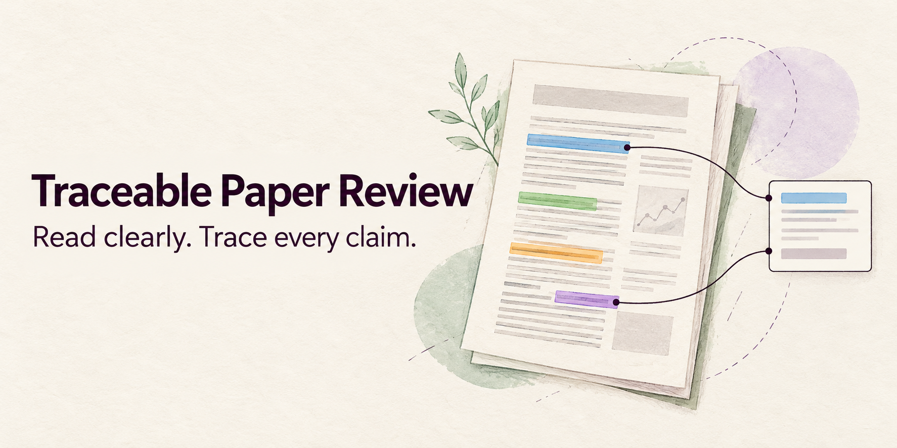
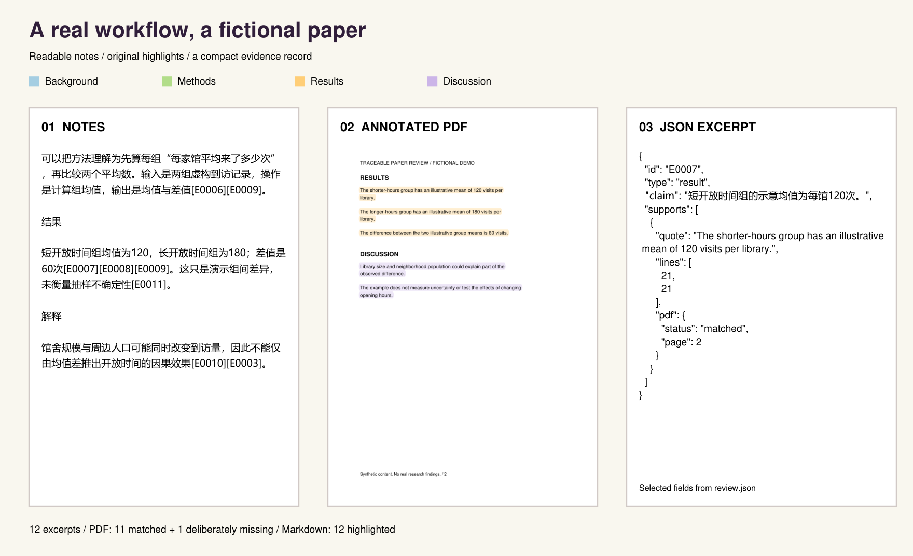

## Traceable Paper Review

[](https://github.com/zhuangcg/traceable-paper-review/actions/workflows/tests.yml)

[中文](README.md) · English · [Skill instructions](SKILL.md) · [Chinese instructions](SKILL.zh-CN.md)



**Grounded claims. Annotated papers.**

Connect AI interpretations back to original evidence, and give readers an annotated starting point instead of a blank paper.

A skill for Codex and Claude Code with two complementary benefits:

- **Check the interpretation:** important claims retain original words and locations, so you can inspect what the AI understood.
- **Read with annotations ready:** colored highlights and Chinese comments save the first round of manual markup.

Unmatched excerpts are reported openly; automatic annotations are a starting point for your own reading.

### See it before installing



The [public example](examples/README.md) is entirely fictional and was processed with the actual scripts. It contains 12 evidence excerpts: 11 highlighted in the PDF, one deliberately missing from that PDF, and all 12 highlighted in Markdown. These are example-specific counts, not a benchmark or accuracy claim.

- [Read the notes](examples/output/notes.md)
- [Open the annotated PDF](examples/output/paper.annotated.pdf)
- [Inspect the annotated Markdown](examples/output/paper.annotated.md)
- [Inspect the compact JSON](examples/output/review.json)

### What you get

| Feature | What it does |
|---|---|
| Plain explanations | Explains inputs, steps, outputs and limits before technical details |
| Traceable claims | Keeps original quotes and source locations next to evidence IDs |
| Useful flowcharts | Uses concrete sentences rather than vague “data → methods → results” boxes |
| Color annotations | Blue background/theory, green data/methods, orange results, purple discussion/limits |
| Honest gaps | Lists unmatched, skipped and unexecuted annotations per excerpt |
| Small final folder | Notes + one JSON; requested annotated copies and their images |

Example citation placement: `The paper reports an association[E0001](#e0001).`

### Requirements and PDF preparation

- **Core notes and checks:** Python 3.9+ standard library. The included demonstration was exercised on Python 3.11.
- **PDF highlights:** PyMuPDF and a PDF with a readable text layer. This is not an OCR engine.
- **PDF-only papers:** prepare a readable Markdown version first. For complex layouts, tables and formulas, we recommend [MinerU — official GitHub repository](https://github.com/opendatalab/MinerU). Keep its image directory alongside the Markdown and review conversion errors. Conversion quality varies; it does not guarantee correct evidence or successful highlights.
- **AI installation is allowed:** when needed for the requested workflow, your agent may create a local virtual environment and install dependencies, while respecting your environment permissions. Private papers should not be sent to online converters without permission.

Minimal optional PDF setup, using [PyMuPDF's official installation guidance](https://pymupdf.readthedocs.io/en/latest/installation.html):

```bash
python -m venv .venv
.venv/bin/python -m pip install PyMuPDF
```

Windows PowerShell:

```powershell
py -m venv .venv
.\.venv\Scripts\python.exe -m pip install PyMuPDF
```

Then use that environment's Python to run the skill scripts. Install **PyMuPDF**, not the unrelated package named `fitz`. MinerU has separate model/hardware requirements; follow its official README instead of treating it as a tiny dependency.

### Install in Codex or Claude Code

The repository root is the complete skill folder. The commands below use the actual repository URL. Choose the directory for your agent and copy the whole folder, not only SKILL.md.

| Agent | Personal installation | Project-only installation |
|---|---|---|
| Codex | `~/.agents/skills/traceable-paper-review/` | `.agents/skills/traceable-paper-review/` |
| Claude Code | `~/.claude/skills/traceable-paper-review/` | `.claude/skills/traceable-paper-review/` |

macOS / Linux, choose the command for your agent:

```bash
git clone https://github.com/zhuangcg/traceable-paper-review.git ~/.agents/skills/traceable-paper-review
# Claude Code:
git clone https://github.com/zhuangcg/traceable-paper-review.git ~/.claude/skills/traceable-paper-review
```

Windows PowerShell:

```powershell
git clone https://github.com/zhuangcg/traceable-paper-review.git (Join-Path $env:USERPROFILE '.agents\skills\traceable-paper-review')
# Claude Code:
git clone https://github.com/zhuangcg/traceable-paper-review.git (Join-Path $env:USERPROFILE '.claude\skills\traceable-paper-review')
```

For a project-only install, use the project-relative path in the table instead. If a destination already exists, inspect it before updating; do not delete an existing skill blindly. Start a new session if the agent does not discover it. Official references: [Codex skills](https://learn.chatgpt.com/docs/build-skills), [Claude Code skills](https://code.claude.com/docs/en/skills).

### Ask your AI to install it

**Codex prompt**

```text
Install the complete traceable-paper-review skill from https://github.com/zhuangcg/traceable-paper-review.git
into my personal Codex skills folder (~/.agents/skills/traceable-paper-review).
Inspect SKILL.md and scripts first. Preserve an existing same-named skill;
do not overwrite it without resolving the difference. Check Python.
If PDF support is needed, you may create a task-local virtual environment
and install PyMuPDF subject to this environment's permissions.
Do not execute downloaded installer pipelines or request credentials.
Report the installed path, version, and whether a new session is needed.
```

**Claude Code prompt**

```text
Install the complete traceable-paper-review skill from https://github.com/zhuangcg/traceable-paper-review.git
into ~/.claude/skills/traceable-paper-review for my personal Claude Code.
Inspect the instructions and scripts, preserve any existing installation,
check Python, and prepare PyMuPDF in a local virtual environment if needed.
Respect environment permissions; do not change unrelated settings.
Tell me how to invoke /traceable-paper-review and verify discovery.
Do not claim client verification if you cannot actually inspect the client.
```

### Use it

Codex: mention `$traceable-paper-review`. Claude Code: invoke `/traceable-paper-review`.

```text
Use traceable-paper-review to read <PAPER_FOLDER>.
Prefer the existing Markdown and keep its images.
Explain complex methods and results in plain language, with original evidence.
Put citations before sentence punctuation. Draw a flowchart with complete sentences.
Create colored PDF and Markdown copies, and list every annotation failure.
If dependencies are missing, you may install what is needed in a local venv.
Save a compact final result to <NEW_OUTPUT_FOLDER>.
```

If you need to convert PDF first, ask the agent to consult [MinerU's official instructions](https://github.com/opendatalab/MinerU), check the machine requirements and keep document processing local unless you authorize another route.


Grounded tags use #phenomenon/name, #method/name and the other fixed namespaces in notes; absent dimensions do not become hashtags.

### Final files and boundaries

```text
notes.md
review.json
paper.annotated.pdf       # when requested and supported
paper.annotated.md        # when requested
<referenced image folders>
```

Only known generated sidecars are removed after a successful final audit and JSON write. Unknown files and source papers are preserved. Use a new working folder for later revisions. CSV is opt-in.

Exact matching can miss passages because of columns, page breaks, formulas and conversion differences. A successful match does not prove a scientific conclusion. Markdown colors and heading navigation depend on the viewer; PDF import into Zotero has not been validated. The notes explicitly retain these limits.

### Development and licensing

Run all tests with `python tools/run_tests.py`; PDF tests require PyMuPDF. Rebuild the fictional example in a fresh checkout without examples/output using `python examples/build_demo.py`.

Code and original demo content: [MIT](LICENSE). Dependencies keep their own licenses; no third-party papers are bundled. Logo and hero are AI-generated; [asset provenance](docs/ASSETS.md) records prompts and image use. No affiliation with OpenAI, Anthropic or MinerU is implied.
