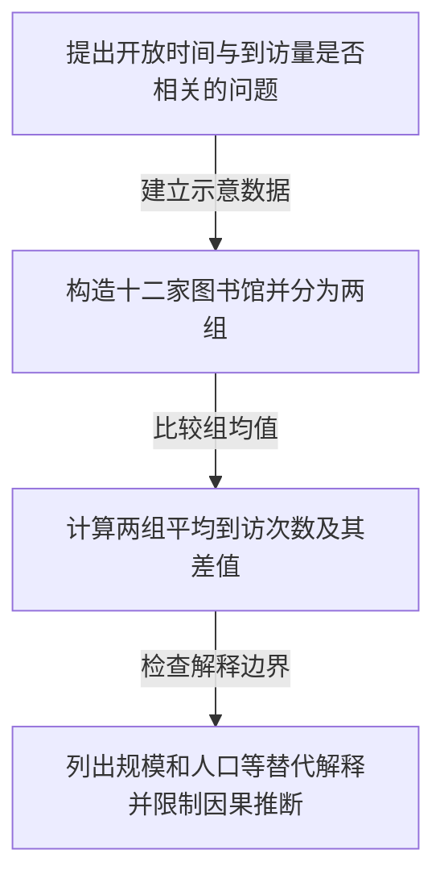

## 图书馆开放时间与到访记录：纯演示

> 全部文字和数字均为自建虚构材料，用来展示流程，不代表真实研究。

## 内容提要

演示比较开放时间较短与较长的两组图书馆，示意均值分别为120和180次[E0002](#e0002)[E0007](#e0007)[E0008](#e0008)。这些数字来自演示设定，不能推出延长开放时间会增加到访[E0001](#e0001)[E0003](#e0003)。

## 研究背景与研究问题

问题是两类图书馆的到访次数是否不同，而不是检验某项开放时间政策的效果[E0002](#e0002)[E0011](#e0011)。

## 理论基础与关键概念

本演示未采用正式理论框架。相关关系与因果关系需要区分[E0003](#e0003)。

## 研究区域、数据与指标

示例没有真实研究区。虚构记录覆盖十二家图书馆的一周，两组各六家[E0004](#e0004)[E0005](#e0005)。

## 研究设计与方法

可以把方法理解为先算每组“每家馆平均来了多少次”，再比较两个平均数。输入是两组虚构到访记录，操作是计算组均值，输出是均值与差值[E0006](#e0006)[E0009](#e0009)。

## 研究结果

短开放时间组均值为120，长开放时间组为180；差值是60次[E0007](#e0007)[E0008](#e0008)[E0009](#e0009)。这只是演示组间差异，未衡量抽样不确定性[E0011](#e0011)。

## 讨论与解释

馆舍规模与周边人口可能同时改变到访量，因此不能仅由均值差推出开放时间的因果效果[E0010](#e0010)[E0003](#e0003)。

## 核心研究主线

N1 [E0002](#e0002)；N2 [E0005](#e0005)；N3 [E0009](#e0009)；N4 [E0010](#e0010)。箭头表示演示步骤。

## 五维关键词标签

- **现象**：#phenomenon/图书馆到访差异 [E0002](#e0002)
- **理论**：未涉及
- **方法**：#method/组均值比较 [E0006](#e0006)
- **数据**：#data/虚构到访记录 [E0004](#e0004)
- **政策**：未涉及

## 待核验事项与后续研究

最后一条故意只放进 Markdown，因此应在 PDF 显示未匹配，并在笔记里保留说明[E0012](#e0012)。

## 阅读覆盖与证据质量

全文是可直接检查的自建演示；PDF 为两页文字层文档。成功定位不代表现实世界的结论有效。

<!-- TPR:EVIDENCE:START -->

## 原文证据与标注状态

标注按每条原文片段分别报告；未找到或未生成时不会猜测位置。

颜色：蓝色＝背景与理论；绿色＝数据与方法；橙色＝结果；紫色＝讨论与局限；灰色＝其他。

- PDF：11/12 个片段已标注；未标注：E0012（片段1）。
- Markdown：12/12 个片段已标注；未标注：无。

### E0002

**类别：** 背景/理论

**对应论断：** 演示问题是开放时间较长的图书馆是否也有更多到访。

**解释边界：** 仅核实虚构演示文本的表述；不是现实世界的科学证据。

**片段 1｜源 MD L7–L7：**

> The example asks whether libraries with longer opening hours also record more visits.

- PDF：已高亮（物理页 1）
- Markdown：已高亮（源文行 7）

### E0007

**类别：** 结果

**对应论断：** 短开放时间组的示意均值为每馆120次。

**解释边界：** 仅核实虚构演示文本的表述；不是现实世界的科学证据。

**片段 1｜源 MD L21–L21：**

> The shorter-hours group has an illustrative mean of 120 visits per library.

- PDF：已高亮（物理页 2）
- Markdown：已高亮（源文行 21）

### E0008

**类别：** 结果

**对应论断：** 长开放时间组的示意均值为每馆180次。

**解释边界：** 仅核实虚构演示文本的表述；不是现实世界的科学证据。

**片段 1｜源 MD L23–L23：**

> The longer-hours group has an illustrative mean of 180 visits per library.

- PDF：已高亮（物理页 2）
- Markdown：已高亮（源文行 23）

### E0001

**类别：** 背景/理论

**对应论断：** 本材料纯属虚构演示，不是科学研究。

**解释边界：** 仅核实虚构演示文本的表述；不是现实世界的科学证据。

**片段 1｜源 MD L5–L5：**

> This document is an entirely fictional demonstration, not a scientific study.

- PDF：已高亮（物理页 1）
- Markdown：已高亮（源文行 5）

### E0003

**类别：** 背景/理论

**对应论断：** 两项指标存在关系并不证明因果。

**解释边界：** 仅核实虚构演示文本的表述；不是现实世界的科学证据。

**片段 1｜源 MD L9–L9：**

> A relationship between opening hours and visits would not establish causation.

- PDF：已高亮（物理页 1）
- Markdown：已高亮（源文行 9）

### E0011

**类别：** 讨论/局限

**对应论断：** 演示没有测量不确定性，也没有测试延长开放时间的效果。

**解释边界：** 仅核实虚构演示文本的表述；不是现实世界的科学证据。

**片段 1｜源 MD L31–L31：**

> The example does not measure uncertainty or test the effects of changing opening hours.

- PDF：已高亮（物理页 2）
- Markdown：已高亮（源文行 31）

### E0004

**类别：** 数据/方法

**对应论断：** 虚构数据包含一周内十二家图书馆。

**解释边界：** 仅核实虚构演示文本的表述；不是现实世界的科学证据。

**片段 1｜源 MD L13–L13：**

> The fictional dataset contains twelve libraries observed during one illustrative week.

- PDF：已高亮（物理页 1）
- Markdown：已高亮（源文行 13）

### E0005

**类别：** 数据/方法

**对应论断：** 将十二家图书馆分为六家与六家的两组。

**解释边界：** 仅核实虚构演示文本的表述；不是现实世界的科学证据。

**片段 1｜源 MD L15–L15：**

> Six libraries are placed in a shorter-hours group and six in a longer-hours group.

- PDF：已高亮（物理页 1）
- Markdown：已高亮（源文行 15）

### E0006

**类别：** 数据/方法

**对应论断：** 方法是比较两组每馆到访次数的均值。

**解释边界：** 仅核实虚构演示文本的表述；不是现实世界的科学证据。

**片段 1｜源 MD L17–L17：**

> The method compares the average number of visits between the two groups.

- PDF：已高亮（物理页 1）
- Markdown：已高亮（源文行 17）

### E0009

**类别：** 结果

**对应论断：** 两组示意均值之差为60次。

**解释边界：** 仅核实虚构演示文本的表述；不是现实世界的科学证据。

**片段 1｜源 MD L25–L25：**

> The difference between the two illustrative group means is 60 visits.

- PDF：已高亮（物理页 2）
- Markdown：已高亮（源文行 25）

### E0010

**类别：** 讨论/局限

**对应论断：** 图书馆规模和周边人口可能解释部分差异。

**解释边界：** 仅核实虚构演示文本的表述；不是现实世界的科学证据。

**片段 1｜源 MD L29–L29：**

> Library size and neighborhood population could explain part of the observed difference.

- PDF：已高亮（物理页 2）
- Markdown：已高亮（源文行 29）

### E0012

**类别：** 其他

**对应论断：** 此句故意仅存在于 Markdown，用于演示 PDF 漏标提示。

**解释边界：** 仅核实虚构演示文本的表述；不是现实世界的科学证据。

**片段 1｜源 MD L33–L33：**

> This Markdown-only sentence deliberately demonstrates a missing PDF match.

- PDF：未标注：未找到唯一的精确匹配
- Markdown：已高亮（源文行 33）

<!-- TPR:EVIDENCE:END -->
