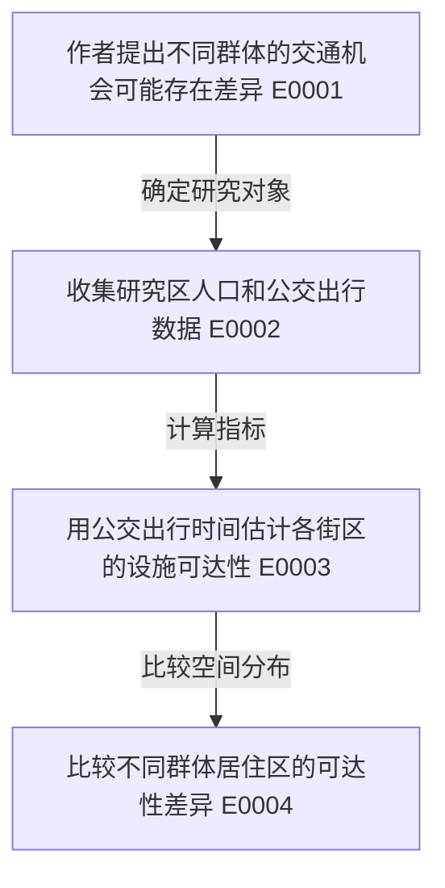

# 主线梳理协议与关系图防误导

核心问题不是“把所有章节连成一条必然因果链”，而是“最少节点解释作者如何从研究问题走到主要证据与结论”。

## storyline.json

```json
{
  "status": "coherent",
  "rationale": "论文围绕单一问题形成清晰分析链条；此处解释证据关联，不夸大因果。",
  "nodes": [
    {"id": "N1", "label": "研究缺口", "role": "problem", "evidence_ids": ["E0001"]},
    {"id": "N2", "label": "数据与研究区", "role": "data", "evidence_ids": ["E0002"]},
    {"id": "N3", "label": "分析方法", "role": "method", "evidence_ids": ["E0003"]},
    {"id": "N4", "label": "主要发现", "role": "result", "evidence_ids": ["E0004"]}
  ],
  "edges": [
    {"from": "N1", "to": "N2", "relation": "研究设计"},
    {"from": "N2", "to": "N3", "relation": "数据用于分析"},
    {"from": "N3", "to": "N4", "relation": "报告结果"}
  ],
  "breaks": [],
  "causal_claims_supported": false
}
```

`status` 只能 `coherent|partial|not_supported`。`coherent` 有 >=3 个证据支持节点；`partial` 允许部分节点/连线缺失，但必须描述 `breaks`；`not_supported` 不需要 Mermaid，但必须给出原因。

**必须逐节点引用**：节点的 `evidence_ids` 指向 verified_direct/verified_synthesis；`N...` 对应的中文标签在图下证据索引处核对，不得创造缺少原文支持的政策建议、理论推导或机制。

**关系的语义**：`→` 表示论文报告的研究/论证顺序，不表示实证因果箭头。若识别策略不支持因果，则节点或文字只能写“关联/观察/比较”，不能“导致/影响了”。如果 Discussion 是作者推测，可加 `(作者解释，未直接检验)`，不可把这条讨论变成已验证机制。

## Mermaid 建议（只在 coherent/partial 且证据充足时）



图下列出节点证据链接。示例仅说明句子的具体程度，并非任何论文的事实；实际节点必须给出论文的具体对象、动作或观察。箭头表示研究流程，不是因果识别成功的证明。

`partial` 时只绘制确有证据关系的部分，并在正文写“研究链条存在以下断裂：……”。`not_supported` 时写“无法从原文建立一条可核验的核心研究主线”，清楚描述是多问题并列、论文段落不完整还是论证缺失。
